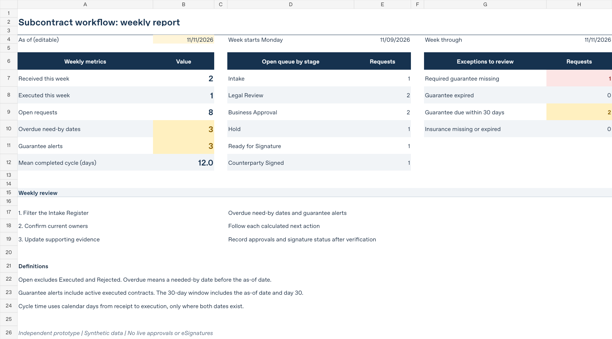

# Subcontract workflow and construction contracts

**Approval routing · Contract administration · Workflow controls · Owner-side risk analysis**

A local Python workflow, an editable Excel register and two legal work samples show how a subcontract moves from intake through approval, ordered signature records and ongoing date tracking. The records and approval thresholds are fictional.

## Inspect the work

- [Workflow specification](Ingrid_Kao_Subcontract_Workflow_Specification.pdf): fields, approval rules, signature order, reporting and integration requirements.
- [Excel tracker](Ingrid_Kao_Subcontract_Workflow_Tracker.xlsx): ten requests, formula-based routing, date alerts and a weekly scorecard.
- [Owner-side construction issues](Ingrid_Kao_Owner_Side_Construction_Issues.pdf): AIA A201-2017 and Taiwan PCC model terms, with proposed owner-side actions.
- [Workflow source and operating guide](engine/README.md), [policy](engine/approval_rules.json) and [tests](engine/test_workflow.py).
- [Primary source register](SOURCE_REGISTER.md).

## Run the prototype

Python 3.10+ and its standard library are sufficient. From this folder:

```sh
cd engine
python3 -m unittest -v test_workflow.py
python3 workflow.py --db practice_events.jsonl demo
python3 workflow.py --db practice_events.jsonl verify
python3 workflow.py --db practice_events.jsonl report --as-of 2026-11-11 --out-dir practice_exports
```

On Windows, use `py` in place of `python3`. [Step-by-step exercises](START_HERE.md) demonstrate approvals, document holds and the two signature events. These are local demonstration records; an eSignature provider and authenticated identities are separate integration requirements.

## Verified baseline

The 38 existing tests pass. Regenerated JSON, CSV and Slack-ready exports match the saved outputs. The unchanged fixture produces these figures as of November 11, 2026:

| Measure | Result |
|---|---:|
| Received this week | 2 |
| Executed this week | 1 |
| Open requests | 8 |
| Overdue requests | 3 |
| Guarantees expiring within 30 days | 2 |
| Missing required guarantee | 1 |

Finance joins only above $50,000; Executive joins only above $250,000. Nonstandard terms require Senior Legal at every value. Approval does not establish authority to sign.



## Data and operating scope

The workbook and engine use the same starting register. Later edits do not synchronize automatically. The engine generates local reports; it does not send Slack messages. Event checks, source files, policy settings and expected outputs are available for inspection.
